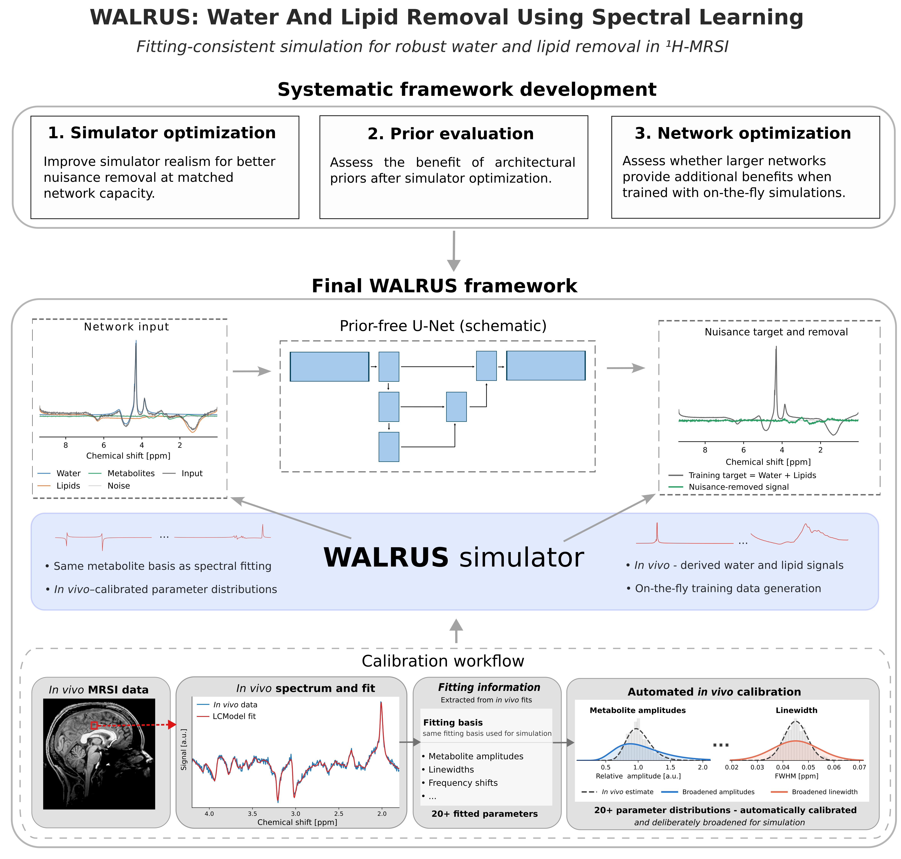

# WALRUS

WALRUS is a research codebase for learning-based removal of nuisance water and lipid signals from proton magnetic resonance spectroscopic imaging (¹H-MRSI) data. It builds on the original WALINET idea, but the current repository is organized around configuration-driven simulation, empirical simulator calibration, model training, and inference on complex-valued MRSI FIDs.

The project supports configurable U-Net and Y-Net model families:

- U-Net models with configurable depth and channel count;
- Y-Net models with an additional L2/lipid-projection input branch.

The original WALINET method was published in [Weiser et al., 2024](https://doi.org/10.1002/mrm.30402), and the original source code is available at [weiserjpaul/WALINET](https://github.com/weiserjpaul/WALINET).

> Note  
> The MRSI datasets, fitted LCModel results, trained checkpoints, generated spectra, and paper graphics are not distributed with this repository. They are expected to exist locally and are intentionally ignored by Git.

## Concept



## Documentation

More detailed documentation is split into:

- [Simulation](docs/simulation.md)
- [Calibration](docs/calibration.md)
- [Training](docs/training.md)
- [Inference](docs/inference.md)
- [Data formats](docs/data_formats.md)

## Repository layout

```text
WALRUS/
├── configs/                 YAML configuration files
│   ├── Simulation/          simulator and distribution configs
│   ├── Training/            model-training configs
│   └── PaperFig1/           evaluation configs for paper figures
├── docker/                  container build/launch files and dependencies
├── docs/                    user-facing documentation
├── scripts/                 command-line workflows
│   ├── SimulationScripts/   training-data, basis, water/lipid utilities
│   ├── trainingScripts/     model training entry points
│   ├── inference/           inference scripts for prepared datasets
│   ├── DataPrepScripts/     site-specific data conversion helpers
│   └── evaluation/          paper/evaluation utilities
├── src/walinet/             Python package
│   ├── config/              config schemas and builders
│   ├── data/                data loading and CombinedCSI I/O
│   ├── inference/           FID inference and pipeline code
│   ├── model/               neural-network models
│   ├── training/            training loops and fixed-pool support
│   ├── training_data/       simulator, basis handling, resources
│   └── paper_figures/       reproducible figure helpers
└── tests/                   unit tests and optional integration tests
```

Local datasets, generated outputs, fitted maps, graphics, metabolite-mode resources, and checkpoints are intentionally kept outside version control.

## Installation

The historical recommended environment is the Docker setup:

```bash
bash docker/build_docker.sh
bash docker/launch_docker.sh
```

For an existing Python environment, install the packages listed in:

```text
docker/requirements.txt
```

During development, run commands from the repository root and ensure that `src/` is on the Python path. `pytest.ini` does this automatically for tests.

## Quick start

### 1. Prepare data

Place each subject in the expected local structure:

```text
<base_dir>/<Subject>/
├── OriginalData/
│   └── data.npy
└── masks/
    ├── brain_mask.npy
    └── lipid_mask.npy
```

See [Data formats](docs/data_formats.md) for shapes, dtypes, and naming conventions.

### 2. Configure simulation

Start from one of the existing simulator configs:

```text
configs/Simulation/3T_on_the_fly.yaml
configs/Simulation/7T_on_the_fly.yaml
configs/Simulation/7T_on_the_fly_WALINET_STYLE.yaml
```

These define acquisition parameters, simulator distributions, masks/resources, and whether acquisition length is fixed or variable.

### 3. Train

Start from:

```text
configs/Training/train_3T.yaml
configs/Training/train_7T.yaml
```

Run:

```bash
python scripts/trainingScripts/train.py --config configs/Training/train_7T.yaml
```

See [Training](docs/training.md) for warm starts, fixed training pools, and validation behavior.

### 4. Run inference

For NumPy CSI data, the core inference API is in `walinet.inference.fid_inference`. Project-specific scripts live in:

```text
scripts/inference/
```

Typical output is a corrected FID array such as:

```text
OriginalData/data_after_walrus.npy
```

See [Inference](docs/inference.md).

### 5. Test

Fast unit tests:

```bash
python -m pytest -q
```

GPU/data-heavy integration tests are marked separately and are not part of the default test run:

```bash
python -m pytest -q -m integration
```

## Notes on scope

This repository is research software. Some scripts are intentionally site-specific and encode local dataset conventions. The reusable core is the package under `src/walinet/` plus the YAML-driven simulation, training, and inference workflows.
